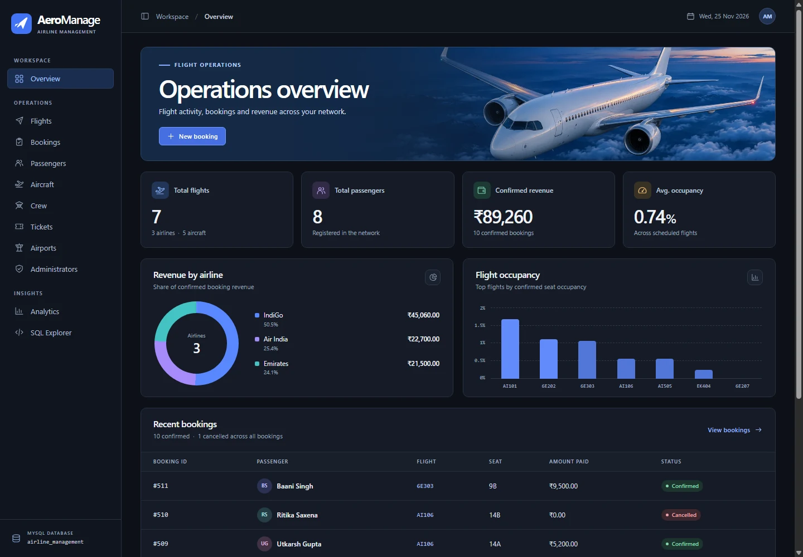

# AeroManage

A local airline administration portal for the 14-relation `airline_management` MySQL database. FastAPI serves Jinja2 pages, and mysql-connector-python runs the SQL directly. The charts, tables and forms work without an external web service. Small vanilla JavaScript files handle mobile navigation and copying SQL.



<details>
<summary>Dashboard artwork</summary>

The masthead uses a local WebP generated with the built-in image-generation tool. [Open the artwork](static/img/flight-deck.webp).

Generation prompt:

> Use case: photorealistic-natural. Wide cinematic panoramic background for an aviation operations dashboard masthead. One modern unbranded white twin-engine passenger jet, close, seen from above and slightly ahead, nose angled to the lower left, wings spread toward upper corners, entire fuselage on the right two-thirds of the image. Flying over soft scattered pale blue cloud tops and distant dark navy mountainous terrain at blue hour, west-facing light glinting off the metal upper body, a rich cobalt twilight sky and atmospheric depth. A restrained aviation editorial photograph, precise anatomy, strong clear silhouette. Left third is naturally open dark blue air for a title overlay. Compose for a very wide 4:1 banner crop, airplane fits within the central horizontal band. No text, lettering, logos or watermarks.

</details>

## Run on Windows

Use Python 3.10 or later and MySQL 8.0 or later. Open PowerShell in the project directory. If the project already has a configured `.venv` and `.env`, skip directly to the Uvicorn command.

```powershell
python -m venv .venv
.\.venv\Scripts\python.exe -m pip install -r requirements.txt
if (!(Test-Path .env)) { Copy-Item .env.example .env }
notepad .env
```

Set `DB_HOST`, `DB_PORT`, `DB_USER`, `DB_PASSWORD` and `DB_NAME` to match the connection that opens the existing database in MySQL Workbench. The account needs SELECT on the project relations and view. The forms use INSERT on BOOKING, PASSENGER and PASSENGER_PHONE, UPDATE on BOOKING and PASSENGER, and DELETE on PASSENGER_PHONE for contact replacement. Booking creation also needs permission to perform locking reads on the flight, aircraft and model rows. The local `.env` is excluded from Git.

```powershell
.\.venv\Scripts\python.exe -m uvicorn main:app --reload --host 127.0.0.1 --port 8000
```

Open [AeroManage](http://127.0.0.1:8000). Stop Uvicorn with Ctrl+C. Changes to the local `.env` take effect on the next request. This is a local university demonstration with write-capable forms and no sign-in.

**Keep the existing database.** The supplied `airline_management_setup.sql` begins with `DROP DATABASE`. Running AeroManage requires no setup script, automatic seed, schema reset or migration.

## Pages

| Page | Demonstration |
| --- | --- |
| Overview | Network totals, confirmed revenue, average occupancy, airline and flight charts, five most recent bookings and four latest scheduled departures. |
| Flights | Filter by source and destination city. Select a flight for airport details, capacity, available seats, assigned crew and booking records. |
| Bookings | Search by ID, passenger name, seat or flight. Combine flight and status filters. Create a confirmed or pending booking, or review and cancel a booking. |
| Passengers | Search by ID, name, email or phone. Register a passenger, edit their email and multiple phone numbers, and inspect booking history. |
| Aircraft | Filter fleet registrations by airline and inspect model, seating capacity, weight and base airport. |
| Crew | Filter crew assignments by flight and designation. The roster includes staff awaiting assignment. |
| Tickets | Compare fares, percentage discounts, extra luggage, flexible travel and meals. |
| Airports | Filter the airport, city and country directory by country and city. |
| Administrators | Inspect administrators, contact details, assigned airports and links to their managed flights. |
| Analytics | Compare airline revenue, rank flights by confirmed revenue, inspect occupancy and available seats, and find frequent passengers and above-average payments. |
| SQL Explorer | Browse the 17 demonstrations, inspect highlighted SQL, copy a statement and run it to see rows, result count and elapsed execution/fetch time. |

## Database logic for the viva

- **Geography and fleet.** COUNTRY → CITY → AIRPORT determines location. AIRLINE and AIRCRAFT_MODEL join through AIRCRAFT to FLIGHT_SCHEDULE. The schedule joins AIRPORT twice to identify origin and destination.
- **Staff.** ADMIN manages flights. STAFF_ASSIGNMENT links a member of CREW_STAFF with a flight and records duty and assignment date.
- **Passengers and sales.** PASSENGER_PHONE stores one row per number. BOOKING links a passenger, flight and ticket configuration. Passenger totals are calculated before joining phone numbers to keep a second number from duplicating a booking.
- **Revenue.** Reports sum `AmountPaid` for confirmed bookings. The interface displays INR, following the sample data’s Indian payment context. The schema has no currency column. Enter the actual amount paid, which may differ from a ticket’s catalogue fare.
- **Occupancy.** Each flight’s occupancy equals confirmed booking rows divided by model capacity. The dashboard averages those percentages across all scheduled flights. A LEFT JOIN keeps flights with zero bookings in both measures. The overview chart shows up to seven flights with the highest occupancy. Analytics lists every flight.
- **Available seats.** The operational pages subtract all existing seat allocations from capacity. The original academic query 12 subtracts confirmed bookings only. On a flight containing a cancelled booking the two results differ. The Explorer preserves the original statement and explains this distinction.
- **Cancellation.** The existing `UNIQUE (Flight_id, Seat_no)` applies to every status. Cancellation updates the status and retains the seat, amount and audit history. Pending and cancelled seats continue to consume allocations. The app uses the existing constraint without a seat-reuse migration.
- **Booking transactions.** A dedicated connection takes a database-scoped MySQL named lock to allocate the next integer booking ID. The schema uses manually assigned primary keys. A `FOR UPDATE` read locks the flight during seat and capacity checks, while shared locks protect the passenger and ticket references. Booking insertion, commit and lock release use the same connection. Database constraints provide the final check. The model stores capacity without a seat map, so the app checks seat-label uniqueness, length and remaining capacity.
- **Passenger transactions.** Registration allocates a passenger ID under a separate named lock. Updating contacts locks the passenger row, updates their email and replaces their phone rows in a single transaction. Errors roll back the whole operation.
- **SQL Explorer.** Each integer selection maps to a fixed SELECT from `Project.sql`. Request data cannot supply SQL. The application never runs the setup statements or the supplied view DDL. Query 17 reads `Confirmed_Bookings`. If this view is missing, a database owner can select the project schema in Workbench and explicitly run `sql/create_confirmed_bookings_view.sql`. This optional script creates the view and refuses to replace an existing object.

## Project map

| Location | Contents |
| --- | --- |
| `main.py`, `database.py`, `ui.py` | FastAPI application, connection/transaction lifecycle and shared Jinja filters. |
| `routes/` | Server-rendered pages and booking/passenger form handlers. |
| `schemas.py`, `reservation_store.py` | Pydantic form validation, booking SQL and passenger SQL. |
| `operations_sql.py`, `reporting.py` | Flight and directory queries, reporting calculations and chart presentation. |
| `Project.sql`, `explorer_queries.py` | Original demonstrations and the Explorer catalogue. Keep these files together. |
| `templates/`, `static/` | Jinja pages, responsive CSS, local artwork and browser scripts. |
| `tests/` | Transaction/validation tests, Explorer checks and optional read-only MySQL checks. |

## Verification

```powershell
.\.venv\Scripts\python.exe -m unittest discover -s tests -v
```

The default suite uses a mocked connector for write paths. To compare flight totals and city filters with actual records in the configured database, enable the read-only tests.

```powershell
$env:RUN_MYSQL_READ_TESTS = '1'
.\.venv\Scripts\python.exe -m unittest discover -s tests -v
Remove-Item Env:RUN_MYSQL_READ_TESTS
```

For a browser walkthrough, start with the overview, follow a flight into the crew and booking tables, then compare its available seats with Explorer queries 12 and 15. Query 11 shows the normalized phone records, and queries 13 and 14 demonstrate HAVING and a scalar subquery. Use a disposable database for demonstrations that create, edit or cancel records.

## Troubleshooting

| Symptom | Action |
| --- | --- |
| Access denied, error 1045 | Verify the username, password, host and port by opening the same connection in Workbench. Update `.env` and retry the page. An existing environment variable takes precedence over the corresponding `.env` setting. |
| Connection refused or timed out, error 2003 | Check the MySQL service in Windows Services and the port in Workbench. Confirm that `DB_HOST` points to that machine. |
| Unknown database, error 1049, or missing table, error 1146 | Use the Workbench schema that contains the supplied 14 relations. Check table-name casing when moving to a case-sensitive server. |
| Query 17 reports a missing view | Follow the optional view-creation step above using an account with CREATE VIEW privileges. |
| Save fails with a privilege error | Grant the runtime account the specific project-table privileges listed in the setup instructions. |
| Seat is unavailable after cancellation | The original booking still holds its seat label. Choose a different unused seat on a flight with remaining allocations. |
| Virtual environment activation is blocked | The commands above invoke the environment’s Python directly and work without activating PowerShell scripts. |
| Port 8000 is in use | Stop the earlier Uvicorn process or use `--port 8001` and open the corresponding localhost URL. |
